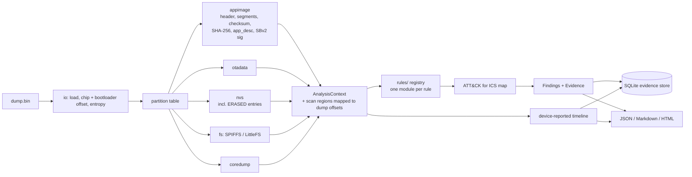
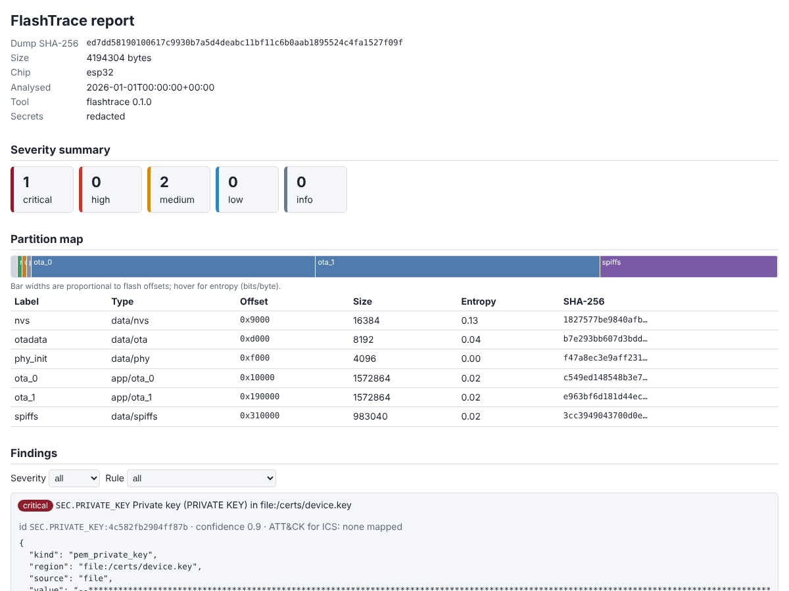

# FlashTrace

**Forensic triage for ESP32-family SPI flash dumps.**

An ESP32 flash dump holds the whole device: bootloader, partition table, both OTA
firmware slots, the NVS key/value store (Wi-Fi passwords, tokens, counters),
filesystems and crash dumps. Reading it by hand with a hex editor and five different
vendor tools is slow and easy to get wrong. FlashTrace parses the dump with
bounds-checked, deterministic parsers and produces an evidence-linked report of what
is on the device, which secrets are exposed, what changed between two dumps, and
whether the firmware shows signs of tampering or rollback.

## What makes it different

- **Evidence-linked findings.** Every finding cites the absolute offset, length,
  partition and SHA-256 of the exact supporting bytes. Secrets are redacted by default
  while their SHA-256 is kept, so a finding stays verifiable without disclosing it.
- **Deleted NVS recovery.** NVS entries that were erased (entry bitmap `0b00`) are
  parsed and reported as "deleted but recoverable", including chunked blobs.
- **OTA tamper and rollback detection.** Slot divergence, unknown builds against a
  baseline, secure_version/semver downgrades, PENDING_VERIFY and invalid active slots.
- **Validated against official tooling.** App images are cross-checked field by field
  with `esptool image-info`; FlashTrace's NVS and SPIFFS writers are proven
  byte-identical to `esp-idf-nvs-partition-gen` and ESP-IDF `spiffsgen.py` in CI.
- **Benchmark-validated.** A deterministic corpus of 10 devices with planted
  conditions scores every rule; CI fails on recall < 0.95 or any forbidden finding.
- **Never crashes on hostile input.** Malformed structures become `PARSE.ANOMALY`
  findings; every parser is fuzzed with Hypothesis.

## Quickstart

```bash
python -m pip install -e ".[dev]"
flashtrace analyze dump.bin --out report/ --format html --format json --format md
```

Open `report/report.html` (a single offline file; no external resources). The run
also writes `report/evidence.sqlite`.

## CLI

```
flashtrace analyze dump.bin [--chip auto|esp32|esp32s2|esp32s3|esp32c3|esp32c6]
                            [--baseline known_good_app.bin ...]
                            [--out report_dir/] [--format json|html|md ...]
                            [--reveal-secrets]
flashtrace diff dumpA.bin dumpB.bin --out diff_dir/
flashtrace bench corpus_dir/ --out bench_results.json
```

Exit codes: `0` no high/critical findings, `1` high/critical present (or bench gate
failed), `2` tool error. Without typer installed, `python -m flashtrace` provides the
same commands through an argparse fallback.

```bash
python -m tools.corpus.generate corpus/      # build the 10-device benchmark corpus
flashtrace bench corpus/ --out bench_results.json
```

## Architecture



## Benchmark

Generated from `examples/bench_results.json` (`python -m tools.make_examples`, then
`python -m tools.gen_docs`). Each device also lists every other rule as must-not-fire,
so the false-positive column covers the whole rule set.

<!-- BENCH:BEGIN -->
| Rule | TP | FP | FN | Precision | Recall | F1 |
|---|---:|---:|---:|---:|---:|---:|
| `FS.SUSPICIOUS_FILE` | 1 | 0 | 0 | 1.00 | 1.00 | 1.00 |
| `IMG.SLOT_DIVERGENCE` | 1 | 0 | 0 | 1.00 | 1.00 | 1.00 |
| `IMG.UNKNOWN_BUILD` | 1 | 0 | 0 | 1.00 | 1.00 | 1.00 |
| `NVS.DELETED_SECRET` | 1 | 0 | 0 | 1.00 | 1.00 | 1.00 |
| `NVS.WIFI_CREDENTIALS` | 1 | 0 | 0 | 1.00 | 1.00 | 1.00 |
| `OTA.PENDING_VERIFY` | 1 | 0 | 0 | 1.00 | 1.00 | 1.00 |
| `OTA.ROLLBACK_OR_DOWNGRADE` | 1 | 0 | 0 | 1.00 | 1.00 | 1.00 |
| `PT.MD5_MISMATCH` | 1 | 0 | 0 | 1.00 | 1.00 | 1.00 |
| `SEC.API_KEY` | 1 | 0 | 0 | 1.00 | 1.00 | 1.00 |
| `SEC.FLASH_ENCRYPTION_LIKELY` | 1 | 0 | 0 | 1.00 | 1.00 | 1.00 |
| `SEC.NO_FLASH_ENCRYPTION` | 9 | 0 | 0 | 1.00 | 1.00 | 1.00 |
| `SEC.NO_SECURE_BOOT` | 1 | 0 | 0 | 1.00 | 1.00 | 1.00 |
| `SEC.PRIVATE_KEY` | 1 | 0 | 0 | 1.00 | 1.00 | 1.00 |
| **Overall** | **21** | **0** | **0** | **1.00** | **1.00** | **1.00** |

Gate (recall ≥ 0.95, no forbidden rule, clean_control quiet): **PASS**
<!-- BENCH:END -->

## Example reports

`examples/<device>/report.{html,json,md}` for every corpus device, plus
`examples/diff_clean_vs_forced_rollback/`. Reports only; dumps are generated at test
time and never committed.


*Screenshot of `examples/pem_private_key_in_spiffs/report.html` (synthetic corpus device).*

## Documentation

- [`docs/rules.md`](docs/rules.md) — every rule: severity, trigger, false-positive notes,
  ATT&CK for ICS mapping (generated).
- [`docs/report-schema.md`](docs/report-schema.md) — JSON report schema.
- [`CLAUDE.md`](CLAUDE.md) — design rules and verified on-flash format notes.
- [`PROGRESS.md`](PROGRESS.md) — development log, known gaps, items needing review.

## Limitations

- **No decryption.** Encrypted flash (flash encryption) and encrypted NVS are detected
  and reported, not decrypted; structural parsing is skipped for likely-encrypted dumps.
- **No signature verification.** Secure Boot V2 signature blocks are detected
  structurally only; signatures are not verified without a public key.
- **SPIFFS assumptions.** Only the ESP-IDF default SPIFFS configuration is parsed (page
  256, block 4096, 32-byte names, 4-byte metadata). Deleted-page semantics are assumed.
- **LittleFS offsets.** File content is located by search; non-contiguous files are
  reported without a precise dump offset.
- **Wi-Fi blob layout.** Key names are verified; the exact blob layout written by the
  closed-source Wi-Fi driver is decoded defensively.
- **Synthetic benchmark.** The corpus is generated with official-tool-equivalent writers;
  results on real devices may differ. The heuristics (generic tokens, slot divergence)
  can produce false positives on real firmware.
- ATT&CK for ICS techniques are attached only where the mapping is unambiguous; most
  rules are marked `review: true` in `src/flashtrace/data/attck_ics_map.yaml`.

## Authorised use

FlashTrace is intended for analysing devices you own or are explicitly authorised to
examine: incident response, security research, CTFs and product security reviews.
Secrets are redacted by default; `--reveal-secrets` must be passed explicitly. Do not
use it to extract credentials from devices you are not authorised to examine.

## Licence

MIT. See [`LICENSE`](LICENSE).
